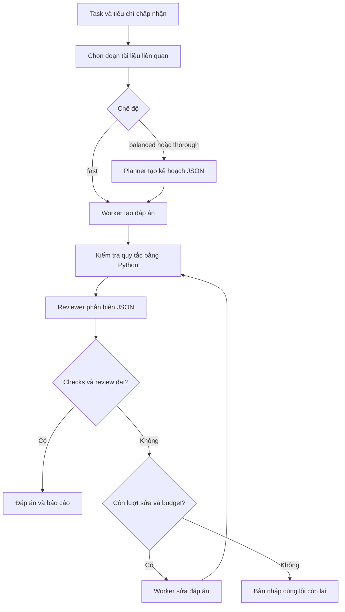

# Kiến trúc

## Luồng xử lý



Mọi request lưu checkpoint trước khi gửi để lượt bị gián đoạn vẫn được tính vào budget.
Kết quả mỗi bước được lưu sau khi nhận. Lỗi JSON được thử sửa tối đa một lần;
lỗi transport không tự retry để tránh request tính phí lặp lại.

## Trách nhiệm các vai trò

| Vai trò | Đầu vào | Đầu ra | Không được coi là |
|---|---|---|---|
| Planner | Task, checks, đoạn tài liệu | Mục tiêu, tối đa 3 bước, tiêu chí | Bằng chứng công việc đã thực hiện |
| Worker | Task, plan nếu vừa ngữ cảnh, tài liệu | Đáp án/artifact dạng văn bản | Kết quả code đã chạy |
| Reviewer | Task, bản nháp đầy đủ, tài liệu vừa ngữ cảnh | pass/revise/uncertain + lỗi cụ thể | Oracle chứng minh đáp án đúng |
| Python controller | Các output, checks, budget | Trạng thái, điều hướng, checkpoint | Model ngôn ngữ khác |

Không yêu cầu model tiết lộ chuỗi suy nghĩ nội bộ. Output trung gian là kế hoạch ngắn,
tiêu chí có thể quan sát, lỗi và bằng chứng. Đây là những thứ có thể kiểm tra độc lập.

## Lựa chọn cho CPU / RAM 8 GB

Một model Qwen3 1.7B được dùng lại tuần tự cho cả ba vai trò. Không spawn model song song,
không vector database, không embedding model, không container, không cần GPU backend.
Việc chia vai trò giúp làm rõ nhiệm vụ và thêm cơ hội phát hiện lỗi, nhưng cùng trọng số vẫn có
sai lệch chung. Reviewer qua API là lựa chọn cấu hình; cần đánh giá chất lượng/chi phí thực tế.

Context giữ các đoạn liên quan theo số từ khóa trùng, không lưu hội thoại toàn bộ vào prompt sau.
Task-file và source hashes được giữ trong checkpoint để tái kiểm tra nguồn đầu vào.
Source excerpts là dữ liệu không đáng tin về mặt chỉ dẫn; prompt yêu cầu không làm theo lệnh nằm trong tài liệu.
Python runner không có tool thực thi shell; tác động trực tiếp là đọc file được chọn, gọi model và ghi run.

## Giới hạn và độ tin cậy

- `max_calls` áp dụng cho mọi lần thử gửi request, kể cả JSON lỗi/transport lỗi.
- `max_seconds` là thời gian hoạt động cộng dồn các lần chạy/resume; không tính thời gian bạn tắt terminal giữa hai lần.
- `request_timeout` giới hạn chờ socket; không phải tiến trình kill cứng của server.
- Giới hạn output gửi bằng `num_predict` (Ollama) hoặc `max_tokens` (compatible).
- `num_ctx` điều khiển context Ollama; với API là ngân sách prompt của client, không thay context tối đa server.
- Budget input bảo thủ theo byte UTF-8, có khoảng dự phòng. Đây không thay tokenizer chính thức của provider.
- Nếu không vừa, bỏ kế hoạch phụ rồi các đoạn nguồn ít ưu tiên; luôn ghi `omitted`.
- Reviewer thiếu nguồn được trích trong draft phải trả trạng thái `uncertain` do controller áp đặt.
- Bản nháp bị cắt token không được đánh dấu pass.
- Đáp án sau sửa luôn qua checks và review lần nữa; không dùng review cũ để duyệt đáp án mới.
- Không có auto-switch sang API khi local lỗi; quyền gửi ra ngoài nằm ở config bạn chọn.
- Chi phí chỉ ước tính từ usage và giá nhập; thiếu thông tin thì ghi chưa biết. Chi phí điện không được đo.

`state.json` có task, tài liệu và phản hồi, nên file được tạo với quyền 0600 và thư mục run 0700.
API key chỉ được đọc từ biến môi trường, không đưa vào checkpoint. Không theo HTTP redirect khi gọi model.
Chỉ một process được ghi mỗi run; nhiều run khác nhau vẫn có thể chạy nên người dùng cần tránh chạy song song
trên laptop này. Checkpoint là dữ liệu local do người dùng quản lý; không resume file do người lạ gửi.

## Bố cục mã nguồn

```text
astra/
  cli.py         Lệnh terminal và cấu hình run
  config.py      Mặc định và validate cấu hình
  providers.py   Ollama / Chat Completions, HTTP và usage
  context.py     Trích tài liệu và validate checks
  prompts.py     Vai trò, schema, hướng dẫn dùng lại
  engine.py      State machine, budgets, resume, báo cáo
  session.py     Contract, bộ nhớ xuyên run, hash và HANDOFF
configs/         Profile local, compatible API và hybrid
examples/        Task kiểm thử và tài liệu mẫu
tests/           Kiểm thử workflow và HTTP adapter
bin/astra        Launcher không phụ thuộc thư mục terminal
sessions/        Bộ nhớ riêng của từng phiên, không đóng gói mặc định
templates/       Gói bàn giao và chỉ dẫn chống quên cho host AI khác
```

## Cách đánh giá trước khi tăng chi phí

Chọn 10–20 yêu cầu thật và rubric/đáp án tham chiếu trước khi chạy. Chạy cùng bộ yêu cầu bằng:
(1) Ollama trực tiếp, (2) fast, (3) balanced, (4) hybrid nếu có budget API.
Giữ nguyên model, giới hạn output và dữ liệu khi so sánh phù hợp. Chấm đáp án bằng người hoặc tests độc lập;
đừng dùng verdict của chính reviewer làm chỉ số đúng/sai. So sánh tỷ lệ đạt, lỗi nghiêm trọng, thời gian,
số lượt và usage. Chỉ bật thêm vòng sửa hoặc reviewer mạnh khi có cải thiện đo được.

Project hiện cung cấp kiểm thử kỹ thuật và smoke test, không đưa ra benchmark nâng chất lượng so với Astra Ultra.

## Bộ nhớ phiên

`--session` bổ sung một lớp nằm ngoài run. Session chụp config, mode và protocol khi tạo.
Mỗi run chụp contract và revision notes; không tự đọc lại notes giữa các bước hoặc khi resume.
Vì vậy ghi chú thêm sau đó chỉ ảnh hưởng run mới. Hash được đối chiếu trước mỗi request;
config digest cho phép tăng max_calls/max_seconds khi resume, còn model và các tham số khác giữ nguyên.

Mục tiêu, ràng buộc, method và notes loại decision/fact được ghim trong mọi payload.
Recent output chỉ là preview chưa xác minh, có thể bỏ khi thiếu chỗ; open/next cũng có thể bỏ khỏi prompt.
Phần bị bỏ được trace, phần ghim quá dài làm dừng request. Giữ file đầy đủ trên đĩa để mở lại theo nhu cầu.
Không dùng thêm model để tự tóm tắt hay tự quyết định ghi fact, tránh biến suy diễn thành ký ức được chốt.

Sau run, CLI ghi liên kết vào session và dựng HANDOFF.md. Bản output không được tự nâng thành fact/decision.
Run vẫn có báo cáo nếu ghi HANDOFF thất bại; resume run đã xong có thể thử đồng bộ liên kết lại.
Khóa session chỉ bao quanh cập nhật file ngắn, không giữ khóa trong suốt quá trình model chạy.

Xem [guide context](CONTEXT-GUIDE.md) để biết giới hạn và các bước chuyển phiên.
